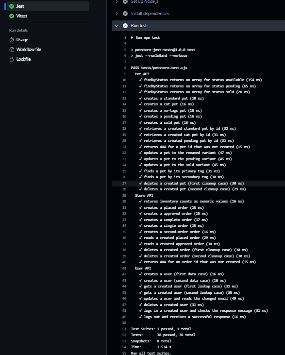
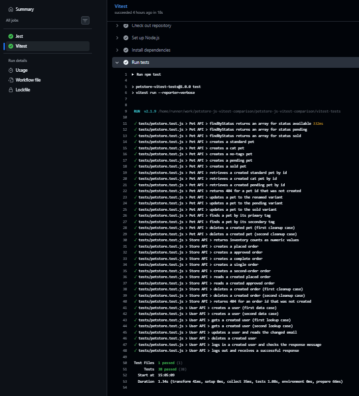

# Petstore API tests: Jest и Vitest

Сравнение двух тестовых раннеров на публичном API Petstore: <https://petstore.swagger.io/v2>. Тесты покрывают разделы `pet`, `store` и `user`, включая позитивные, негативные и параметризованные сценарии.

## Результаты GitHub Actions

| Раннер | Тестов | Успешно | Ошибок | Время |
|---|---:|---:|---:|---:|
| Jest | 38 | 38 | 0 | 1.534 с |
| Vitest | 38 | 38 | 0 | 1.34 с |

[Открыть полный запуск GitHub Actions](https://github.com/ArtAndree/petstore-js-vitest-comparison/actions/runs/45421315008)

## Скриншоты результатов

Скриншоты результатов находятся в папке screenshots:

### Jest



### Vitest



## Запуск локально

Требуется Node.js 18 или новее.

### Jest

```bash
cd jest-tests
npm install
npm test
```

### Vitest

```bash
cd vitest-tests
npm install
npm test
```

Базовый URL по умолчанию: `https://petstore.swagger.io/v2`. При необходимости его можно задать через переменную `PETSTORE_BASE_URL`.

## Структура проекта

- `jest-tests/` — тесты и конфигурация Jest.
- `vitest-tests/` — тесты и конфигурация Vitest.
- `shared/` — общая логика API-тестов.
- `analysis/` — количественный и качественный анализ, ответы на контрольные вопросы.
- `screenshots/` — снимки результатов выполнения тестов.
